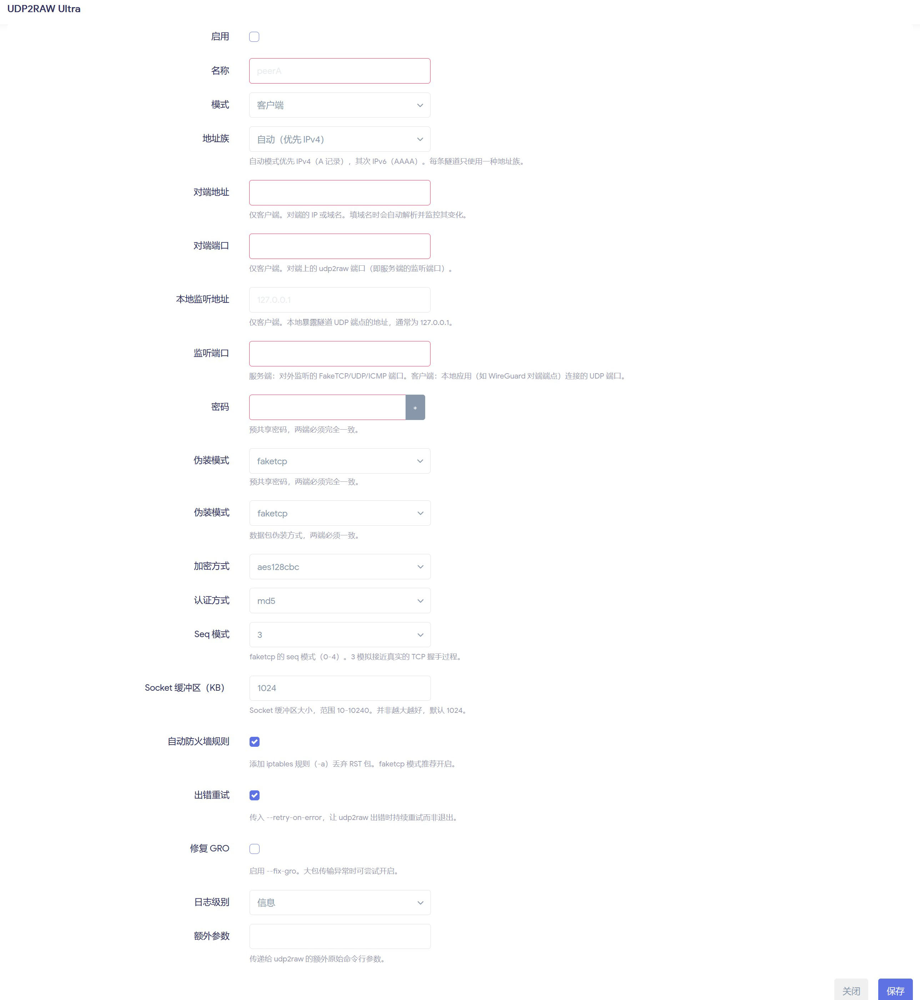
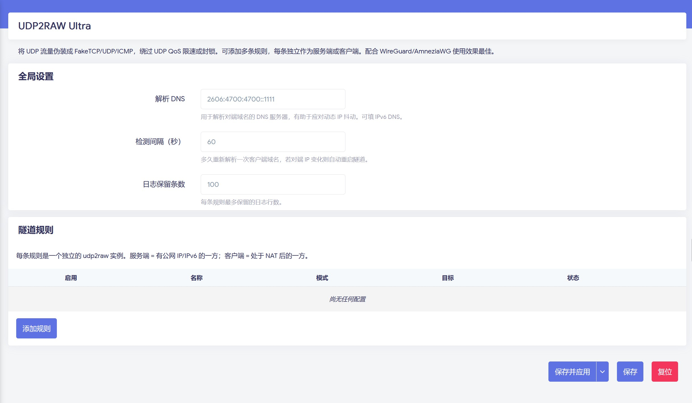

# luci-app-udp2raw-ultra

适用于 OpenWrt / Kwrt / ImmortalWrt 的 [udp2raw](https://github.com/wangyu-/udp2raw) LuCI 网页管理插件。

把 UDP 流量伪装成加密的 FakeTCP / UDP / ICMP 流量，用于绕过运营商对 UDP 的 QoS 限速或封锁。专为搭配 WireGuard / AmneziaWG 设计。

> 本插件是官方 `luci-app-udp2raw` 的替代品，采用新版 JS 客户端渲染的 LuCI 界面（适配 OpenWrt 24.10 / 25.12），解决官方包在新固件上不适配的问题。支持简体中文语言包和多规则列表。

## 界面预览





## 功能特性

- **规则列表** — 可添加多个 udp2raw 实例，每条独立作为**服务端**或**客户端**，可单独启用/停用。
- **地址填 IP 或域名** — 启动时自动判断，填域名会自动解析。
- **地址族选择** — 自动（优先 IPv4，其次 IPv6）/ 仅 IPv4 / 仅 IPv6。
- **DDNS 自动重连** — 客户端规则填域名时，后台守护进程按间隔轮询解析，对端 IP 变化时自动重启对应实例。
- **完整参数覆盖** — 密码、伪装模式（faketcp/udp/icmp）、加密方式（aes128cbc/xor/none）、认证方式、seq 模式、socket 缓冲区、`-a` 自动防火墙规则、`--retry-on-error`、`--fix-gro`、日志级别，以及自定义额外参数。

## 依赖

- `luci-base`：LuCI 网页运行环境
- `udp2raw`：隧道程序
- 固件提供的 `nslookup`（通常由 BusyBox 提供）：域名解析与 DDNS 监控
- `firewall4`：fw4/nftables 防火墙
- `ip-full`：IPv4/IPv6 策略路由

安装时会自动拉取软件包依赖。DNS 查询直接使用固件自带的 `nslookup`，无需额外安装 DNS 工具；自定义精简固件需保留 BusyBox 的 `nslookup` 功能。支持指定 DNS、IPv4/IPv6 地址筛选，指定 DNS 无结果时回退到系统 DNS。

## 安装

APK 固件（独立脚本生成的包未签名）：

```sh
apk add --allow-untrusted ./luci-app-udp2raw-ultra-1.3.3-r16.apk
# 使用中文界面时，同时安装 Release 中的 luci-i18n-udp2raw-ultra-zh-cn APK
```

IPK 固件：

```sh
opkg install ./luci-app-udp2raw-ultra_*.ipk
# 使用中文界面时，同时安装 Release 中的 luci-i18n-udp2raw-ultra-zh-cn IPK
```

请使用与当前固件匹配的软件源安装依赖。插件会安装 `/etc/init.d/udp2raw` 和 `/etc/config/udp2raw`，安装前请先卸载其他管理相同服务的 LuCI 插件，并备份已有配置。

安装后清一下 LuCI 缓存并刷新浏览器：

```sh
rm -f /tmp/luci-modulecache/* /tmp/luci-indexcache*
```

然后进入 **网络 → UDP 流量伪装**（安装简体中文语言包后）。

## 使用教程

udp2raw 的工作原理：**有公网 IP 的一方跑服务端，NAT 后面的一方跑客户端**。客户端把本地某个 UDP 端口的流量加密伪装后发给服务端，服务端解密还原后转发给真实的 UDP 服务（比如 WireGuard）。

### 典型场景：给 WireGuard/AmneziaWG 加一层伪装

假设 B 端路由器有公网、跑着 WireGuard（端口 51820），A 端在 NAT 后面要连它，但 UDP ��限速。用 udp2raw 把这条 WireGuard 隧道包一层 FakeTCP。

#### 服务端配置（B 端，有公网的路由器）

进入 **网络 → UDP 流量伪装**，点**添加规则**：

| 选项 | 填写 | 说明 |
|------|------|------|
| 启用 | ✅ | |
| 名称 | `server` | 任意备注名 |
| 模式 | 服务端 | |
| 监听端口 | `58881` | 对外暴露的 udp2raw 端口，客户端要连这个 |
| 转发到地址 | `127.0.0.1` | 本机的 WireGuard |
| 转发到端口 | `51820` | WireGuard 实际监听端口 |
| 密码 | `你的密码` | 两端必须一致 |
| 伪装模式 | `faketcp` | 两端必须一致 |
| 加密方式 | `aes128cbc` | 两端必须一致 |

保存并应用。别忘了在防火墙放行 TCP `58881`（faketcp 走 TCP）。

#### 客户端配置（A 端，NAT 后面）

同样**添加规则**：

| 选项 | 填写 | 说明 |
|------|------|------|
| 启用 | ✅ | |
| 名称 | `peerB` | 任意备注名 |
| 模式 | 客户端 | |
| 对端地址 | `b.example.com` | B 端的公网 IP 或域名（域名会自动解析+监控） |
| 对端端口 | `58881` | 对应服务端的监听端口 |
| 本地监听地址 | `127.0.0.1` | |
| 监听端口 | `51820` | 本地暴露的 UDP 端口，你的 WireGuard 对端 Endpoint 填这个 |
| 密码 / 伪装模式 / 加密方式 | 同服务端 | **必须和服务端完全一致** |

保存并应用。然后把 A 端 WireGuard 的对端 Endpoint 改成 `127.0.0.1:51820`（也就是本地的 udp2raw 客户端入口），流量就会经 udp2raw 伪装后发往 B 端。

### 地址族说明

一条隧道只能用一种地址族。填域名时：

- **自动** — 先查 A 记录（IPv4），没有再查 AAAA（IPv6）
- **仅 IPv4** — 只查 A 记录
- **仅 IPv6** — 只查 AAAA 记录

如果你的对端是 IPv6 动态地址（很多家宽只有 IPv6 公网），选**仅 IPv6**，并在全局设置里把**解析 DNS** 设成可用的 IPv6 DNS（默认 `2606:4700:4700::1111`）。

### DDNS 自动重连

客户端规则的对端地址填**域名**时，后台会按**全局设置 → 检测间隔**（默认 60 秒）定时解析该域名。一旦解析出的 IP 变了，自动重启对应的 udp2raw 客户端，无需手动干预。填 IP 则不监控。

## 常见问题

**Q：安装时提示 `resolve_conffiles ... /etc/config/udp2raw-opkg`？**
这是升级时的正常保护提示，不是错误——opkg 保留了你现有的配置，把新默认配置放到了 `-opkg` 旁边。想用���新配置就 `rm /etc/config/udp2raw` 后重装。

**Q：卸载后配置还在吗？**
本插件的 `postrm` 会在**真正卸载**（`opkg remove` 或 `apk del`）时自动删除 `/etc/config/udp2raw`；**升级**时则保留配置不动。

**Q：菜单不显示 / 界面空白？**
清缓存刷新：`rm -f /tmp/luci-modulecache/* /tmp/luci-indexcache*`，然后浏览器 Ctrl+F5。

**Q：连不上？**
- 两端的密码、伪装模式、加密方式、认证方式必须**完全一致**
- 服务端防火墙要放行对应端口（faketcp 走 TCP）
- 用 `logread | grep udp2raw` 看日志

## 加入 feeds 编译

仓库按 feed 组织，包定义和安装文件位于 `luci-app-udp2raw-ultra/` 子目录。以下命令在 OpenWrt / ImmortalWrt / PonWrt 源码或 SDK 根目录执行，标准 `packages`、`luci` feeds 需先准备好。

在 `feeds.conf.default`（若使用自定义 `feeds.conf`，则修改该文件）中加入：

```text
src-git udp2raw_ultra https://github.com/altman08/luci-app-udp2raw-ultra.git
```

更新、安装软件包定义：

```sh
./scripts/feeds update udp2raw_ultra
./scripts/feeds install -p udp2raw_ultra luci-app-udp2raw-ultra
make menuconfig
```

在 **LuCI → Applications** 中选中 `luci-app-udp2raw-ultra`。选为 `y` 内置到固件，选为 `m` 仅生成安装包；`udp2raw` 等依赖由构建系统自动选择，无需手动启用。

```sh
make defconfig
make package/luci-app-udp2raw-ultra/compile V=s
# 安装包：bin/packages/<arch>/udp2raw_ultra/，格式由源码或 SDK 决定
```

完整固件编译则在 `make defconfig` 后执行常规的 `make`。

本地开发时，可把同一条 feed 改为指向仓库根目录：

```text
src-link udp2raw_ultra /path/to/luci-app-udp2raw-ultra
```

## GitHub Actions 打包发布

提交并推送到本 fork 后，在 **Actions → Release OpenWrt packages → Run workflow** 中填写发布标签（例如 `v1.3.3-r16`），选择是否标记为预发布，然后启动流水线。

流水线参考 `luci-proto-n2n` 的 SDK 构建及发布流程、`luci-app-udpspeeder` 的通用前端与语言包收集方式。使用 OpenWrt 官方 SDK Action，仅选择 `x86_64` 作为构建环境：

- OpenWrt `24.10.5`：生成 IPK 前端和简体中文语言包。
- OpenWrt `25.12.5`：生成 APK 前端和简体中文语言包。

前端只有 JS、Shell，语言包只有翻译数据，均为 `all` / `noarch` 通用包，可用于相应系统版本的不同架构（包括 AN7581 / AN7583）。每次发布共四个安装包：`luci-app-udp2raw-ultra` 的 APK、IPK，以及 `luci-i18n-udp2raw-ultra-zh-cn` 的 APK、IPK。保留 SDK 原始文件名，不附加构建架构；另提供各格式的 SHA-256 校验文件。全部构建成功后自动创建或更新 GitHub Release；也可以从 Artifacts 下载，构建失败时上传日志。

官方 SDK feeds 缺少 `udp2raw` 包定义，因此 CI 临时 feed 使用固定 ImmortalWrt 提交中的后端配方，并校验 SHA-256，让 SDK 正常处理依赖。后端和其他依赖不会上传到 Release。固件编译仍通过原有 feeds 自动选择依赖。

无需额外配置发布 Token，使用仓库自带的 `GITHUB_TOKEN`。在 fork 的 Actions 页面启用工作流后即可运行。安装时仍需从与固件匹配的软件源获取 `udp2raw`、`firewall4`、`ip-full`、`luci-base` 等依赖；后端需与设备系统和架构兼容。

## 不使用 SDK 直接打包

本插件只有 JS 和 Shell 文件，可以使用 apk-tools 3 的 `mkpkg` 直接生成 `noarch` APK，无需交叉工具链：

```sh
APK_TOOL=/root/.local/bin/apk.static ./build-apk.sh
# 产物：dist/luci-app-udp2raw-ultra-1.3.3-r16.apk
```

默认使用 PATH 中的 `apk`，也可以用 `APK_TOOL` 指定工具路径、`DIST_DIR` 指定输出目录。脚本会写入 OpenWrt 的服务安装/卸载钩子及配置文件清单，并校验生成的 APK。此方式生成未签名的插件包，不包含 `udp2raw` 等依赖的二进制文件。

IPK 仍可使用 `bash build-ipk.sh` 生成。两种包可以同时保存在 `dist/`，重新打包不会清空该目录。这两个独立脚本只生成前端；语言包由 SDK 流水线生成，未安装语言包时界面显示英文。

## 文件结构

| 路径 | 作用 |
|------|------|
| `luci-app-udp2raw-ultra/root/etc/config/udp2raw` | UCI 配置（全局选项 + 规则列表） |
| `luci-app-udp2raw-ultra/root/etc/init.d/udp2raw` | procd 服务，每条启用的规则起一个 udp2raw 实例 |
| `luci-app-udp2raw-ultra/root/usr/share/udp2raw-ultra/monitor.sh` | DDNS 监控守护进程 |
| `luci-app-udp2raw-ultra/root/usr/share/udp2raw-ultra/resolve.sh` | 共用的 nslookup 域名解析与地址族筛选 |
| `luci-app-udp2raw-ultra/root/usr/share/luci/menu.d/*.json` | 菜单注册 |
| `luci-app-udp2raw-ultra/root/usr/share/rpcd/acl.d/*.json` | ACL 权限 |
| `luci-app-udp2raw-ultra/htdocs/luci-static/resources/view/udp2raw-ultra/udp2raw.js` | 网页界面 |

## 许可

Apache-2.0
